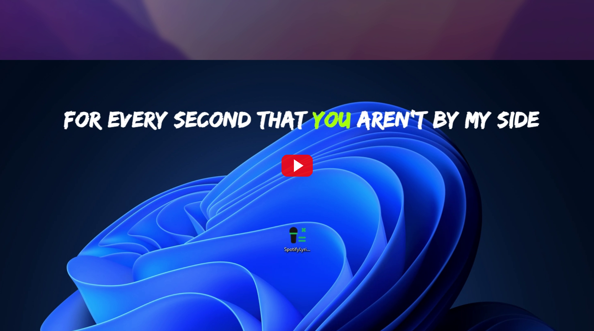
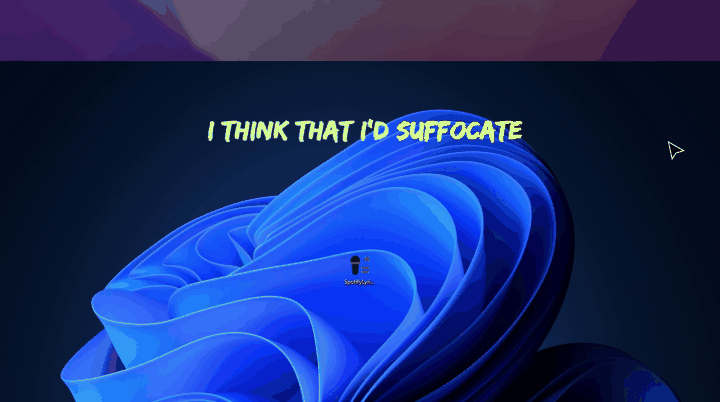
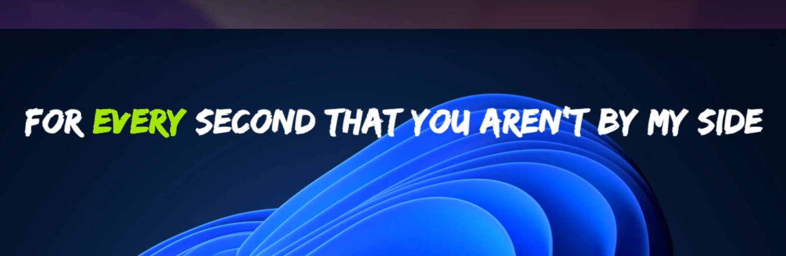
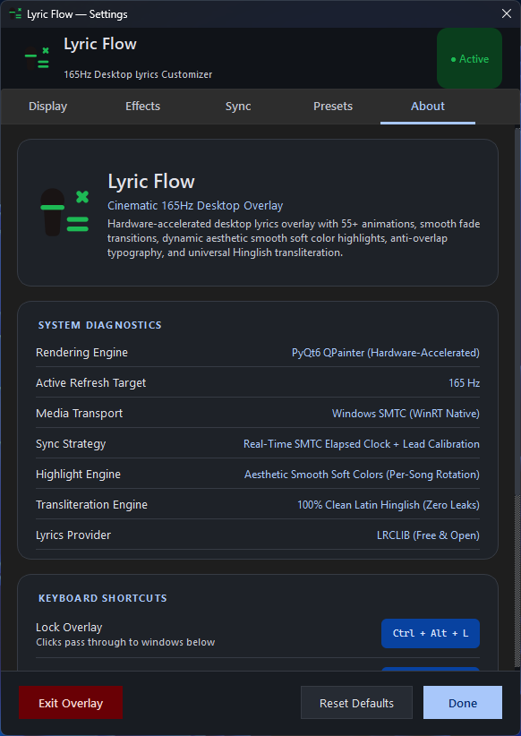

<p align="center">
  
</p>

<h1 align="center">LyricVibe</h1>

<p align="center">
  <b>Cinematic 165Hz Floating Lyrics Overlay for Spotify</b><br>
  <i>Real-time synchronized lyrics floating borderless on your screen — no Spotify Premium required.</i>
</p>

<p align="center">
  
  
  
  
  
</p>

---

## Demo Video

<p align="center">
  <a href="https://youtu.be/0j6qynWk0WA" target="_blank" rel="noopener noreferrer">
    
  </a>
</p>

<p align="center">
  <a href="https://youtu.be/0j6qynWk0WA" target="_blank" rel="noopener noreferrer">
    <b>Watch the Full 1080p 60FPS Demonstration on YouTube &rarr;</b>
  </a>
</p>

<p align="center">
  
</p>

---

## Screenshots

<p align="center">
  <b>Synchronized Floating Overlay</b><br>
  
</p>

<p align="center">
  <b>Modern Customizer Panel</b><br>
  
</p>

---

## Features

- **Pure Floating Overlay**: Zero window borders, zero background — only clean typography floating seamlessly over games, browsers, and desktop apps.
- **No Spotify Premium Required**: Intercepts Windows SMTC telemetry directly; works out of the box with Spotify Free and Premium.
- **Zero Configuration**: No API keys, developer tokens, or Spotify login credentials required.
- **165Hz Smooth Rendering**: Hardware-accelerated PyQt6 rendering at your monitor's native refresh rate (60–240Hz).
- **70+ Dynamic Animations**: Cinematic crossfades, whip pans, bass drops, hyper zooms, word-by-word reveals, soft glows, star glints, and directional motion blur.
- **Expanded Highlight Palette & Custom Color Picker**: Rich darker shades (Spotify Green, Deep Emerald, Crimson, Royal Purple, Midnight Indigo, Deep Teal) and neon tones, plus full custom color picker support.
- **Universal Multi-Script Transliteration**: Automatically converts Hindi (Devanagari), Urdu, Punjabi (Gurmukhi), Bengali, Gujarati, Tamil, and Telugu into natural Roman text.
- **Smart LRCLIB Matching**: Automatically strips movie tags, featured artists, producer credits, and remaster suffixes for accurate lyrics retrieval.
- **Settings Customizer**: Double-click or press `Ctrl + Alt + S` to customize fonts, colors, physics, and timing offsets.

---

## Quick Start

### Windows Setup Installer (Recommended)
Download `LyricVibe-Setup-v1.1.0.exe` from [Releases](https://github.com/Arsh-Pathan/LyricVibe/releases) and run the setup wizard:
- Creates Start Menu and Desktop shortcuts automatically.
- Optional startup launch with Windows in the background.
- Clean uninstallation via Windows Settings (Add or Remove Programs).

### Standalone Portable Executable
Download `LyricVibe.exe` or `LyricVibe-v1.1.0-Windows.zip` from [Releases](https://github.com/Arsh-Pathan/LyricVibe/releases).
Double-click `LyricVibe.exe` to run. No installation or Python required.

### One-Click Spotify + Overlay Launcher
Run `Start LyricVibe.bat` in the root folder to open Spotify and the overlay together in one click.

### Run from Source
```bash
git clone https://github.com/Arsh-Pathan/LyricVibe.git
cd LyricVibe
pip install -r requirements.txt
python main.py
```

---

## Essential Controls

| Shortcut | Action |
|:---|:---|
| **Click & Drag** | Move lyrics anywhere on screen |
| **`Ctrl + Alt + S`** | Open Settings Customizer (or double-click text / tray icon) |
| **`Ctrl + Alt + L`** | Lock / Click-through mode (clicks pass through text) |
| **`Ctrl + Alt + H`** | Hide / Show overlay |
| **`[` / `]`** | Shift lyrics 0.5s earlier / later |
| **`Ctrl + Alt + Q`** | Quit overlay cleanly |
| **System Tray** | Access settings, lock, visibility, and quit via notification area |

---

## Documentation

Comprehensive guides and architectural specifications are available in the [`docs/`](docs/) directory:

- [**Architecture & Pipeline**](docs/ARCHITECTURE.md) — WinRT SMTC telemetry, LRCLIB API, Hinglish parser, and 165Hz rendering engine.
- [**Setup & Installation Guide**](docs/SETUP.md) — Detailed installation methods, virtual environments, startup automation, and troubleshooting.
- [**Animation System & Physics**](docs/ANIMATIONS.md) — Breakdown of all 55+ animations, cubic easing curves, motion blur, and neon palettes.
- [**Controls & Customization**](docs/CONTROLS.md) — Full hotkey index, mouse gestures, timing calibration, and settings guide.
- [**Building the Executable**](docs/BUILDING.md) — Packaging into a standalone `.exe` using PyInstaller.
- [**Release Notes**](docs/RELEASE_NOTES.md) — Changelog and highlights for v1.0.0.

---

## License

MIT License — see [LICENSE](LICENSE) for details.
