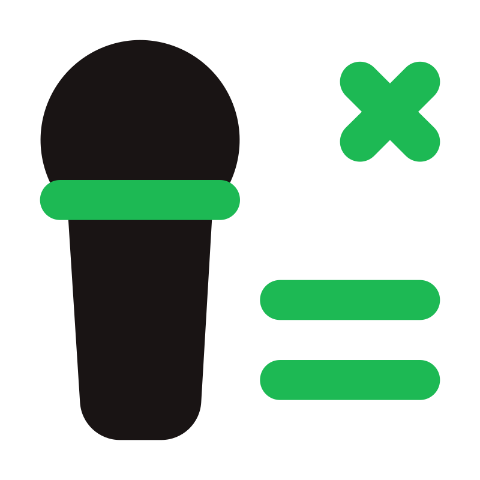

<p align="center">
  
</p>

<h1 align="center">Lyric Flow</h1>
<p align="center">
  <b>Cinematic 165Hz Floating Lyrics Overlay for Spotify</b><br>
  <i>Real-time synchronized lyrics floating borderless on your screen — no Spotify Premium required.</i>
</p>

<p align="center">
  
  
  
  
</p>

---

## ✨ Features

| Feature | Description |
|:---|:---|
| **Pure Floating Text** | Frameless, transparent overlay — no window borders, no background. Just clean white text on your screen. |
| **No Premium Required** | Reads playback data from Windows SMTC (System Media Transport Controls) — works with Spotify Free & Premium. |
| **No API Keys / Login** | Zero configuration. No Spotify developer credentials needed. |
| **165Hz Smooth Rendering** | Hardware-accelerated PyQt6 rendering at your monitor's native refresh rate (60–240Hz). |
| **18 Cinematic Animations** | Scale fade, word reveal, kinetic snap, chromatic split, motion blur, glow bloom, star glints, hand-drawn underlines, and more — with weighted rarity. |
| **Hindi → Hinglish** | Automatically converts Devanagari & Urdu lyrics into natural Roman Hinglish (like Spotify). |
| **Smart Track Matching** | Strips Spotify movie tags (`From "Dabangg"`, `Remastered`, etc.) for accurate LRCLIB lookups. |
| **7clouds Typography** | Montserrat & Poppins fonts — the same style used by popular lyric channels. |
| **Settings Window** | Run the app a second time (or press `Ctrl+S`) to open a dark-themed customization panel. |
| **Auto Wake/Hide** | Appears when Spotify plays, vanishes when paused or closed. |
| **Global Hotkeys** | Lock overlay, toggle visibility, adjust sync, and quit — all via keyboard shortcuts. |

---

## 🚀 Quick Start

### Option 1: Standalone EXE (Recommended)
```
dist\SpotifyLyrics.exe
```
Double-click to run. No Python installation needed.

### Option 2: Python Script
```bash
pip install -r requirements.txt
python main.py
```

### Option 3: Start Spotify + Lyrics Together
```
Start Spotify + Lyrics.bat
```
Opens both Spotify and the overlay in one click.

### Option 4: Auto-Start with Windows
Run `enable_autostart.bat` once — the overlay will launch silently with Windows and appear only when Spotify plays.

---

## ⌨️ Controls & Hotkeys

| Action | Shortcut |
|:---|:---|
| **Drag Lyrics** | Click and drag the text |
| **Lock / Click-Through** | `Ctrl + Alt + L` |
| **Hide / Show** | `Ctrl + Alt + H` |
| **Open Settings** | `Ctrl + S` or double-click text |
| **Quit** | `Ctrl + Alt + Q` |

---

## 🎬 Animation System

The overlay ships with **18 animation types** selected by weighted rarity:

| Frequency | Animations |
|:---|:---|
| **Common** | Scale Fade, Slide Up, Word Reveal, Kinetic Snap, Drift Dissolve |
| **Uncommon** | Glow Bloom, Hand-Drawn Underline, Smooth Crossfade |
| **Rare** | Chromatic Split, Shimmer Sweep, Wave Ripple, Star Glint, Elastic Slingshot |
| **Very Rare** | Horizontal Blur Streak, Drop Settle, Spotlight Halo, Letter Tracking, Strobe Pulse |

Animations adapt to lyric pacing — fast bursts trigger kinetic snaps, slow vocal lines get word-by-word reveals.

---

## 🏗️ Architecture

```
lyric-flow/
├── main.py                  # PyQt6 overlay window & IPC entry point
├── spotify_client.py        # SMTC-based playback reader (PowerShell subprocess)
├── spotify_listener.ps1     # WinRT PowerShell script for SMTC data
├── lyrics_fetcher.py        # LRCLIB lyrics fetcher with smart title cleaning
├── hinglish_converter.py    # Devanagari & Urdu → Roman transliteration engine
├── animation_engine.py      # 18 weighted animation types & easing curves
├── settings_window.py       # Dark-themed PyQt6 settings dialog
├── settings_manager.py      # JSON-based persistent settings
├── config.py                # Static configuration defaults
├── fonts/
│   ├── Montserrat.ttf       # 7clouds-style primary font
│   └── Poppins-Bold.ttf     # Bold accent font
├── build_exe.bat            # PyInstaller build script
├── run.bat                  # Quick dev launcher
├── enable_autostart.bat     # Add to Windows Startup
├── disable_autostart.bat    # Remove from Windows Startup
├── Start Spotify + Lyrics.bat
├── requirements.txt
└── README.md
```

---

## 🔧 Building the EXE

```bash
# Install dependencies
pip install -r requirements.txt

# Build standalone executable
build_exe.bat
# → Output: dist/SpotifyLyrics.exe
```

---

## 🛠️ How It Works

1. **Playback Detection** — A background PowerShell script reads Windows SMTC via WinRT APIs, streaming JSON lines with track info, position, and timestamps every 250ms.

2. **Lyrics Fetching** — Track names are cleaned (stripping movie tags, featured artists, remaster notes) and queried against [LRCLIB](https://lrclib.net) — a free, open lyrics database with no API key required.

3. **Hinglish Transliteration** — Hindi (Devanagari) and Urdu (Perso-Arabic) lyrics are converted to natural Roman Hinglish with comprehensive nukta handling, schwa deletion, and a safety-net sanitizer that guarantees zero non-Latin characters leak through.

4. **Rendering** — PyQt6 paints the overlay at your monitor's native refresh rate using cubic ease-out and elastic bounce easing curves, with per-frame motion blur, glow bloom, and procedural effects.

---

## 📋 Requirements

- **OS:** Windows 10 / 11
- **Python:** 3.10+ (only if running from source)
- **Spotify Desktop App** (Free or Premium)

---

## 📄 License

MIT License — see [LICENSE](LICENSE) for details.
