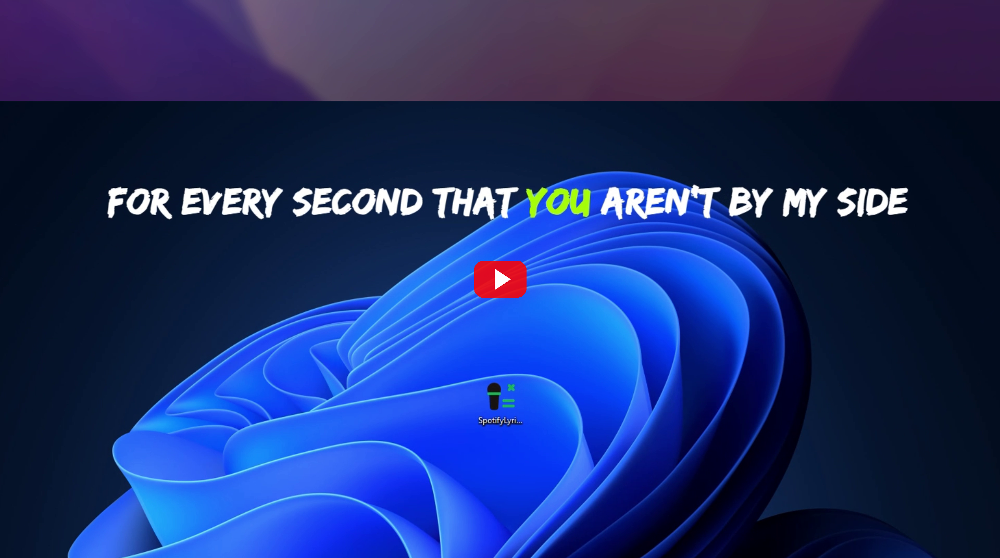
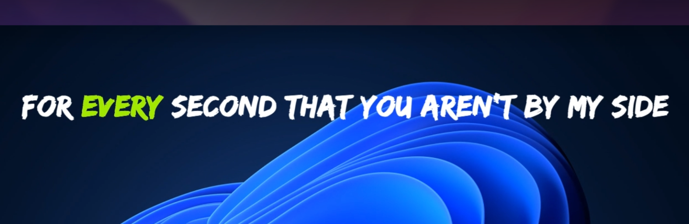
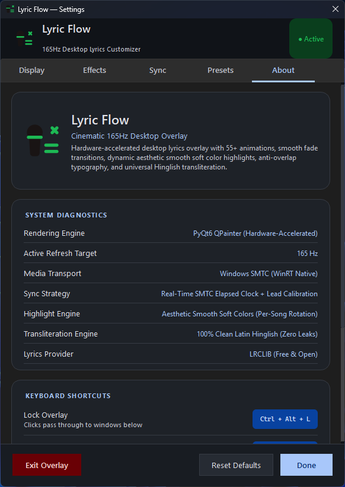

# Release Notes

## LyricVibe v1.1.0 — Word-Level Sync, Black & White UI, Multi-Artist Matching & Setup Installer

### Key Features & Improvements in v1.1.0

- **Word-to-Word Synchronized Highlighting**:
  - Full Enhanced LRC parser decoding inner syllable and word-level timestamps (`<mm:ss.xx>`).
  - Active word-level highlight tracking that illuminates words precisely in sync with vocal phrasing.
  - Hand-drawn animated underline effect that sketches underneath the active word with natural pencil tremors.

- **Natural Phrasing & Interlude Preservation**:
  - Resolved early line disappearances: lyrical lines remain visible throughout natural vocal breathers and short pauses (`gap < 8.0s`) until the subsequent line starts.
  - Extended instrumental interludes (`gap >= 8.0s`) linger with generous padding (`min(gap * 0.75, vocal_end + 3.0)`) before fading out gracefully.

- **Obsidian Black & White Minimalist UI**:
  - Transformed the Settings customizer into a clean monochrome design.
  - Obsidian dark surfaces (`#0A0A0C`), zinc container cards (`#141417`, `#222226`), pure white typography, and white active tab indicators.
  - Redesigned 74px header featuring a framed icon badge, bold title typography, silver subtitle, and bordered version pill.

- **Multi-Artist & Field-Specific Lyrics Matching**:
  - Multi-artist extractor (`get_all_artists`) automatically detects primary composers and secondary vocalists (e.g., Pritam, Arijit Singh).
  - Exact GET and field-specific queries (`api/search?track_name=...&artist_name=...`) directly query LRCLIB composite B-tree indices to prevent HTTP 503 Server Overload errors.
  - Safe duration and metadata parsing preventing `TypeError` on null duration or missing fields.
  - Reduced negative cache TTL to 30 seconds for quick recovery from momentary connection hiccups.

- **Comprehensive Unicode & Tag Normalization**:
  - Normalizes Unicode smart quotes (`’`, `‘`, `“`, `”`) and dashes (`–`, `—`, `…`).
  - Enhanced tag stripping handles `- Explicit`, `- Acoustic`, `- Deluxe`, `- Instrumental`, `- Remastered`, and trailing `- <Artist>` tags.

- **Rare Experimental Physics Animations**:
  - Added rare high-energy animations: `supernova_burst`, `falling_down_screen`, `vortex_black_hole`, `quantum_vaporize`, `lightning_strike_glitch`, and `matrix_rain_cascade`.
  - Supports 2D character rotation and particle drift physics during line transitions.

- **Topmost Window Watchdog**:
  - Periodic Win32 `SetWindowPos` watchdog actively maintains `HWND_TOPMOST` and `WS_EX_TOPMOST` styles, preventing background apps, browsers, or games from occluding the overlay.

- **Professional Windows Setup Installer**:
  - Native Windows installer (`LyricVibe-Setup-v1.1.0.exe`) built with Inno Setup 6.
  - Guided setup wizard with options for Desktop shortcut, Start Menu folder, and clean uninstaller in Windows Add or Remove Programs.
  - Self-contained portable executable (`LyricVibe.exe`) and portable zip archive (`LyricVibe-v1.1.0-Windows.zip`).

- **Test Suite & CI/CD Stability**:
  - 117 automated tests passing across Python 3.10, 3.11, 3.12, and 3.13.
  - Fully mocked registry and isolated headless test runs for reliable GitHub Actions execution.

---

## LyricVibe v1.0.0 — Cinematic 165Hz Floating Lyrics Overlay for Spotify

**Real-time synchronized lyrics floating borderless on your screen — no Spotify Premium required.**

---

### Demo Video & Screenshots

  
  
<a href="https://youtu.be/0j6qynWk0WA" target="_blank" rel="noopener noreferrer"><b>Watch Full 1080p 60FPS Video Demonstration on YouTube &rarr;</b></a>

  
  
<i>Real-time synchronized floating lyrics with active word highlight and smooth continuous physics.</i>

  
  
<i>Modern dark-themed customization panel with live preview.</i>

---

### Key Highlights

- **Pure Floating Overlay**: Zero window borders, zero background — only pure typography floating seamlessly on top of your games, browsers, and desktop.
- **No Spotify Premium Required**: Reads playback telemetry via Windows System Media Transport Controls (WinRT SMTC). Works out of the box with Spotify Free and Premium.
- **Zero API Keys & Zero Configuration**: Instant startup without needing Spotify developer tokens or Spotify login credentials.
- **165Hz Fluid Rendering**: Hardware-accelerated PyQt6 rendering at your display's native refresh rate (60Hz–240Hz).
- **Continuous Fade Physics**: 100% glitch-free smooth baseline transitions with zero sudden text snapping or jumps.
- **Versatile Highlight Palette**: Rich darker tones (Spotify Green, Deep Emerald, Crimson, Royal Purple, Midnight Indigo, Deep Teal) and ultra-bright neon colors that rotate automatically per song, or can be chosen via the custom color picker.
- **Universal Multi-Script Transliteration**: Automatically converts Devanagari (Hindi), Perso-Arabic (Urdu), Gurmukhi (Punjabi), Bengali, and Gujarati lyrics into clean Latin Roman text with zero missing glyph boxes.
- **55+ Dynamic Animations**: Scale fades, kinetic snaps, word-by-word reveals, soft glows, and directional motion blur.
- **Smart LRCLIB Matching**: Automatically strips movie suffixes, artist tags, remaster notes, producer credits, and viral modifiers for high-accuracy lyrics lookup.

---

### Installation & Quick Start

#### Standalone Executable (No Python Required)
1. Download `LyricVibe.exe` or `LyricVibe-v1.0.0-Windows.zip` below.
2. Run `LyricVibe.exe`.
3. Play music on Spotify — the lyrics will appear automatically!

#### Global Hotkeys
- **Ctrl + Alt + S** or double-click text: Open Settings Customizer
- **Ctrl + Alt + L**: Lock overlay / click-through mode
- **Ctrl + Alt + H**: Hide / Show overlay
- **Ctrl + Alt + [ / ]**: Adjust audio sync offset (-0.5s / +0.5s)
- **Ctrl + Alt + Q**: Quit overlay
